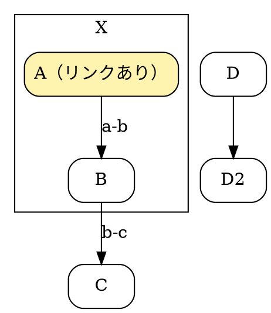

# 要件: 図の中のリンクを拡大ビューアでも効かせる／Graphviz の図でノードをクリックしたら関連を強調する

- 起票: 2026-10-19（foods_web の「レガシー Perl 全体 ER 図」作成中に出た要望）
- 対象: Markdown Preview（このリポジトリ）。文書側（.md）は変更しない
- 状態: 実装済み（v1.20.0。下の「実装で決めたこと」）

## 背景

foods_web の `docs/legacy/perl/er-overview.md` に、Graphviz（```` ```dot ````）で描いた表の地図がある
（表 170 個を「メニュー → アイコン → 表」で敷き詰めた図2-2 など 14 枚）。
各ノードには `URL="#表名"` を付けてあり、プレビューで箱をクリックするとページ末尾の索引へ飛ぶ。

困っていること:

1. 図が大きいので**拡大ビューアで見る**が、拡大ビューアの中では箱をクリックしても飛べない
2. そもそも「この表はどことつながっているか」を **図の中で見たい**。索引へ飛ぶのは遠回りで、
   クリックしたノードに関係する線と相手のノードがその場で光ってほしい

実物: `D:\foodsdev\foods_web\.claude\worktrees\perl-legacy-map\docs\legacy\perl\er-overview.md`
（ブランチ `feature/perl-legacy-map`。develop 取り込み後は `D:\foodsdev\foods_web\docs\legacy\perl\er-overview.md`）。
「図2-2 メニューアイコンごとのテーブル地図」と「図3 第1工場」で試すとよい。

## 現状（コードの根拠）

| 場所 | いまの動き |
|------|------|
| `src/main.ts` `preview.addEventListener("click")`（`closest("a")` を見る方） | プレビュー内の `<a>` クリックを横取り。`href` または `xlink:href` を読み、`#id` なら `document.getElementById(id).scrollIntoView()`、`http(s)` なら外部ブラウザ、相対 `.md` ならタブで開く。**SVG 内の `<a>` も `closest("a")` で拾えるので、プレビュー上では図の中のリンクが効く** |
| `src/main.ts` 図クリックで拡大ビューアを開く方の listener | `closest("a")` があれば何もしない（リンク優先）。それ以外は `openViewer(el)` |
| `src/viewer.ts` `open(el)` | `el.cloneNode(true)` を `stage` に入れて `transform` で拡大縮小する。**複製は `preview` の外にあるので、上のリンク用 listener が届かない**。`stage` の `pointerdown` は `preventDefault()` してドラッグ移動に使い、`pointerup` で「動かさずに図の外を押した」ときだけ閉じる。リンクの処理は無い |
| `src/diagrams.ts` `sanitizeSvg` | DOMPurify の svg プロファイル＋`ADD_ATTR: ["xlink:href"]`。Graphviz が出す `<a xlink:href="#..." xlink:title="...">` と `<g id="...">` は残る（実機で確認済み: プレビューでは飛べる） |

Graphviz（@viz-js/viz）が出す SVG の構造（関連の判定に使える）:

```xml
<g id="graph0" class="graph">
  <g id="icon-d1-kama" class="cluster">          <!-- subgraph に id="..." を付けたとき。付けなければ id="clust1" -->
    <title>cluster_i_d1_kama</title>
    ...
  </g>
  <g id="node12" class="node">
    <title>d1/kama/af_d1_kensa</title>            <!-- DOT のノード id（表示ラベルではない） -->
    <g id="a_node12"><a xlink:href="#af_d1_kensa" xlink:title="製品検査記録（ヘッダ）">
      <path .../><text>af_d1_kensa</text>
    </a></g>
  </g>
  <g id="edge3" class="edge">
    <title>af_d1_kamakikaku&#45;&gt;af_d1_kenpinnippo</title>   <!-- 「tail->head」。無向なら「a--b」 -->
    <path .../><polygon .../>
  </g>
</g>
```

- ノードの識別子は `g.node > title` の文字列。線は `g.edge > title` の `A->B`（`->` は `&#45;&gt;` にエスケープされる）
- 同じラベルのノードが複数あっても DOT の id は別（図2-2 では `メニュー/フォルダ/表名`）
- `URL`/`href` を付けたノードだけ `<a>` で包まれる。付けないノードは `<a>` 無し

## 要件 A: 拡大ビューアの中でも図の中のリンクが効く

- 拡大ビューアで表示中の図（`.viewer-content`）の中の `<a>` を**ドラッグせずにクリック**したら、プレビューと同じリンク処理をする
  - `#id` → **ビューアを閉じてから**本文のその要素へスクロール（索引へ飛ぶ用途。ビューアを開いたままだと見えない）
  - `http(s)://` → 外部ブラウザで開く（ビューアは開いたままでよい）
  - 相対の `.md` → ビューアを閉じてタブで開く
- ドラッグ（3px 以上動かした）で終わったときはリンクを踏まない（いまの「動かさずに図の外で離したら閉じる」判定と同じ流儀）
- リンクのあるノードの上ではカーソルを `pointer` にする（いまは掴み手のまま）
- リンク処理はプレビュー用と**同じ関数**にまとめ、二重実装しない（`main.ts` の `closest("a")` の処理を関数に切り出して両方から呼ぶ）
- 右クリック → 「拡大して見る」で開いたときも同じ

## 要件 B: Graphviz の図でノードをクリックしたら、つながっている線と相手を強調する

### 対象

- ```` ```dot ```` / ```` ```graphviz ```` の図（`.diagram[data-kind=dot|graphviz]`）。
  ```` ```c4 ```` も中身は DOT なので同じ仕組みで効かせる（線が箱を避ける描き方でも `g.edge` の `title` は同じ）
- Mermaid は今回は対象外（SVG の構造が別。ER 図は将来の課題として残す）
- プレビュー上と拡大ビューアの中の**両方**で効く（ビューアは複製なので、複製にも同じ処理を付ける。強調の状態は別々でよい）

### 動き

| 操作 | 結果 |
|------|------|
| ノードをクリック | そのノード、そのノードを端に持つ**すべての線**、線の反対側のノードを強調。それ以外のノード・線・クラスタ枠は薄くする |
| 強調中に別のノードをクリック | そちらに切り替える |
| 強調中のノード（起点）をもう一度クリック | ノードにリンクがあればリンクを踏む（要件 A の処理）。無ければ強調を解除 |
| 図の余白・クラスタの枠をクリック、または Esc | 強調を解除 |
| 強調中の相手ノード（光っている方）をクリック | そのノードを起点にして切り替える |
| マウスを乗せる | 変えない（いまの `title`／`xlink:title` のツールチップのまま） |

- 「つながっている」は **同じ SVG の中の `g.edge`** で判定する。向きは問わない（入る線も出る線も強調）。
  相手は 1 段だけ（相手の相手までは広げない）
- 同じ表が別のノードとして複数ある図（図2-2）では、クリックしたノードそのものの線だけを見る（ラベルが同じ別ノードは対象外）
- ノードにリンクがある場合、**1 回目のクリックは強調、2 回目でリンク**。ワンクリックでリンクへ飛ばさない
  （理由: リンクがある図でも、まず「どことつながっているか」を見たい。索引へ飛ぶのはその次）
- 線が 1 本も無いノードをクリックしたら、そのノードだけ強調（他は薄くなる）。これで「孤立している」ことが分かる

### 見た目

- 強調: ノードの枠を太く（例 2.5px）＋アクセント色、線はアクセント色で太く（例 2.5px）、矢じり（`polygon`）も同色。
  元の塗り（色で意味を持たせている図がある: 黄色＝品目参照など）は**変えない**
- 薄くする: `opacity: 0.25` 程度。クラスタの枠と見出しも薄くする（起点・相手を含むクラスタは薄くしない方が読みやすいが、必須ではない）
- ダークテーマでも読める色にする（`docstyle.css` のアクセント色を使う）
- 強調は CSS クラスの付け外しで行い、SVG の属性を書き換えない（PDF 出力・再描画で元に戻る。状態は保存しない）
- 起点ノードのカーソルは `pointer`

### やらないこと

- 強調状態の保存、URL への反映
- 2 段以上の到達範囲、経路探索
- ノード以外（線やクラスタ）を起点にする強調

## 受け入れ条件

1. 下の DOT を含む .md を開き、プレビューで `B` をクリック → `B`・`A->B`・`B->C`・`A`・`C` が強調され、`D` と `D->D2` が薄くなる。もう一度 `B` をクリック → 強調が消える（`B` にリンクは無い）
2. `A` をクリック → 強調。もう一度 `A` をクリック → `#dest` へスクロールする（`A` にはリンクがある）
3. 図をクリックして拡大ビューアを開き、同じ 1〜2 が中でも動く。2 のリンクはビューアが閉じてからスクロールする
4. ビューア内でノードを押したまま 10px 動かして離す → 移動だけで、強調もリンクも起きない
5. Esc で強調が消える（ビューアが開いていれば Esc はビューアを閉じる方が優先でよい。仕様として決めて書く）
6. ```` ```c4 ```` の図でも 1 が動く
7. PDF 出力に強調状態が出ない
8. vitest: SVG 文字列から「ノード id → 隣接する線とノード」を作る関数の単体テスト（`->`・`--`・`&#45;&gt;` エスケープ・同名ラベル別 id）
9. ヘルプ（`src/help/help.md` の Graphviz の節）に「ノードをクリックすると関連が強調される。リンク付きノードは 2 回目でリンク」を追記

確認用の DOT:



```markdown
<!-- 同じ .md の下の方に -->
## dest
ここへ飛ぶ。
```

## 実装メモ（調べて分かっていること）

- 隣接の計算は、図を描き終えたとき（`diagrams.ts` で `.done` を付けるところ）か、最初のクリック時に SVG ごとに 1 回やって Map に持てばよい。
  `g.node` の `title` → ノード id、`g.edge` の `title` を `->` または `--` で割って両端の id。
  `title` の文字列は DOM から取るので `&#45;&gt;` はデコード済み（`->` になっている）
- 複製（ビューア）側は `open(el)` の `cloneNode` の後に同じ初期化を呼ぶ。複製は DOM が同じ構造なので同じ関数で済む
- リンク処理の切り出し先は `main.ts` のプレビュー用 listener。`openUrl` / `openInTab` / `resolvePath` を使っているので、ビューアからは関数を渡すか `main.ts` 側で `stage` にも listener を付ける
- 図2-2 の規模: ノード約 300・線 0（線は図3〜 にある）。図3 第1工場: ノード 25・線 60。図5 品質保証: ノード 50・線 70。性能上の心配は無い
- `pointerdown` で `preventDefault()` しているため、ビューア内では `click` イベントが出るかを確認する（出なければ `pointerup` で「動いていない」判定のあとに処理する）

## 実装で決めたこと（v1.20.0）

| 項目 | 決めたこと |
|------|------|
| 対象の図 | Graphviz が描いた SVG（ルートに `g.graph` がある）すべて。dot・c4 に加え、アプリが DOT にして描く erd・flow・screen・markmap でも効く。ポート付きの線（`t0:c1->t1:c0`）はポートを外して両端を判定する |
| 強調中の余白クリック（プレビュー） | 強調を解除するだけで、拡大ビューアは開かない。強調していないときの余白クリックは、これまでどおりビューアを開く |
| Esc | ビューアが開いていれば、ビューアを閉じる（強調の解除より優先）。ビューアが閉じていて強調中なら、強調を解除する。強調していないときの Esc はエディタなどに渡す |
| 強調の状態 | DOM のクラス（`gf-active`・`gf-on`・`gf-origin`）だけに持つ。強調中の図を右クリック →「拡大して見る」で開くと、複製も強調したまま開き、そこから続けて操作できる（以後はプレビューと別々） |
| ヘルプ画面 | ヘルプの Graphviz の例でも同じように強調できる（ヘルプの例で試せるように） |
| ビューアのクリック | `pointerdown` を横取りしているので `click` は使わず、`pointerup` で「3px 未満しか動かしていない」と分かったときに `setupViewer({ onTap })` で知らせる |

実装: `src/graphfocus.ts`（隣接の計算と強調。単体テストは `graphfocus.test.ts`）、`src/main.ts` の `followLink`（プレビューとビューアで共通のリンク処理）、`src/viewer.ts` の `onTap`。
受け入れ条件 1〜6 は、main.ts と同じつなぎ方の試験ページを Playwright（Edge）で操作して確認した。7（PDF）は、PDF 出力のときに図を描き直す（強調のクラスを持たない）ことによる。

## 関連

- ADR 0002（画像の注釈）: 図の上の操作を増やすときの前例。注釈は画像のみで、SVG の図は対象外
- `docs/legacy/perl/er-overview.md`（foods_web）の「読み方」に「箱をクリックすると索引へ飛ぶ」と書いてある。要件 B が入ったら「1 回目で関連が光り、2 回目で索引へ」に直す（foods_web 側の作業）
