# Markdown 基本 {#markdown}

## 使用技術・書き方の調べ方
[markdown-it](https://github.com/markdown-it/markdown-it) 15（CommonMark 準拠）で HTML に変換している。表・取り消し線に加え、脚注（markdown-it-footnote）とタスクリスト（markdown-it-task-lists）に対応。コードブロックの色分けは [highlight.js](https://highlightjs.org/) 11。PowerShell・bash・console・.env はこのアプリ独自の色分けで、文の先頭の語をコマンド、その後ろの `-x` を引数として色を付ける（`docker` も `Get-ChildItem` も同じ扱い）。
- 基本の書き方: [CommonMark のヘルプ](https://commonmark.org/help/)
- 表など GitHub 風の書き方: [GitHub Flavored Markdown](https://github.github.com/gfm/)
- 色分けできる言語名: [highlight.js の対応言語](https://highlightjs.readthedocs.io/en/latest/supported-languages.html)

## 見出し
行頭に `#` を 1〜6 個。`#` の後ろには半角スペースが必要。
~~~~example
# 見出し1
## 見出し2
### 見出し3
~~~~

## 段落と改行
空行で段落を分ける。段落内で改行したいときは行末に半角スペース 2 つか `<br>`。
~~~~example
1 行目と同じ段落
（ここは前の行とつながる）

新しい段落。行末にスペース2つで  
改行される。
~~~~

## 強調・取り消し線
~~~~example
**太字** / *斜体* / ***太字斜体*** / ~~取り消し~~ / `インラインコード`
~~~~

## 箇条書き
`-` `*` `+` のどれでもよい。半角スペース 2〜4 個で字下げすると入れ子になる。エディタでは、箇条書きの行で **Tab** を押すと記号ごと字下げされて入れ子になる（**Shift+Tab** で戻す）。
~~~~example
- りんご
- みかん
  - 温州みかん
  - 伊予柑
- ぶどう
~~~~

## 番号付きリスト
番号は全部 `1.` でも自動で連番になる。
~~~~example
1. 準備する
1. 実行する
   1. テスト
   1. 本番
1. 片付ける
~~~~

## タスクリスト
~~~~example
- [x] 設計
- [x] 実装
- [ ] レビュー
~~~~

## リンク
見出しへのリンクは `#見出しの文字`（空白は `-`、記号は除く）。相対パスの `.md` はアプリ内で開く。
~~~~example
[外部サイト](https://example.com)
[同じ文書の見出しへ](#見出し1)
[別の Markdown](./other.md)
<https://example.com>
~~~~

## 画像
相対パスは md ファイルの場所が基準。エディタで Ctrl+V するとクリップボードの画像を「md の名前.assets」フォルダに保存して挿入できる。
~~~~example


ふつうは `` のようにファイルを指定する。サイズを指定したいときは HTML で ``。
~~~~

## 引用
~~~~example
> 引用文です。
> 複数行も書ける。
>> 入れ子の引用
~~~~

## コードブロック
``` の後ろに言語名を書くと色分けされる（ts, js, python, php, rust, go, java, c, cpp, cs, vb, sql, json, yaml, toml, html, css, vue, blade, bash, sh, powershell, ps1, console, env, dockerfile, cmd など）。言語名はコードブロックの左上にラベルとして表示される。`言語名:ファイル名` と書くと（Qiita と同じ書き方）、ラベルにはファイル名が出る。プレビューでコードブロックにマウスを乗せると右上に「コピー」ボタンが出て、コードをクリップボードにコピーできる。
~~~~example
```python
def hello(name: str) -> str:
    return f"Hello, {name}!"
```

```bash:setup.sh
npm install
```

```powershell
docker compose up -d; Get-ChildItem -Path C:\temp | Where-Object { $_.Length -gt 1000 }
```

```console
$ git status --short
 M src/main.ts
```
~~~~

## フォルダ構成（ツリー）
フォルダの階層は、言語名を付けないコードブロックに罫線文字 `├──` `└──` `│` で書く（GitHub や Qiita でよく使う書き方）。同じ階層で最後の項目には `└──`、それ以外には `├──` を付け、下の階層は `│   `（縦線と空白 3 つ）か空白 4 つで字下げする。フォルダ名の最後に `/` を付けるとファイルと見分けやすい。行の右に `#` で役割を書いておくと、設計書で説明しやすい。
~~~~example
```
project/
├── src/
│   ├── main.ts          # 入口
│   └── help/
│       └── help.md      # ヘルプ本文
├── docs/
│   └── design.md
└── README.md
```
~~~~

罫線を使わず、入れ子の箇条書きで書いてもよい（手で直しやすい）。
~~~~example
- project/
  - src/
    - main.ts
  - README.md
~~~~

実際のフォルダからツリーを作るときは、PowerShell やコマンドプロンプトで `tree /F /A` を実行して出力を貼り付ける（`/F` でファイルも出す、`/A` で罫線を `|` `+---` `\---` にする）。罫線文字のまま出したいときは `/A` を外す。
```powershell
tree /F /A C:\work\project
```

## 表
2 行目の `:` の位置で寄せを指定する（`:---` 左 / `:---:` 中央 / `---:` 右）。
~~~~example
| 項目 | 数量 | 単価 |
|:-----|:----:|-----:|
| りんご | 3 | 120 |
| みかん | 10 | 40 |
~~~~

## 水平線
~~~~example
上の文章

---

下の文章
~~~~

## 脚注
~~~~example
本文に脚注を付ける[^memo]。

[^memo]: 脚注の内容はページの最後に表示される。
~~~~

## 折りたたみ（HTML）
一部の HTML タグはそのまま使える（スクリプトなど危険なものは除去される）。
~~~~example
<details>
<summary>クリックで開く</summary>

中身には **Markdown** も書ける。

</details>
~~~~

## エスケープ
記号をそのまま表示したいときは前に `\` を付ける。
~~~~example
\*アスタリスク\* \# シャープ \[角かっこ\]
~~~~

# Mermaid {#mermaid}

## 使用技術・書き方の調べ方
```` ```mermaid ```` で囲んだ部分を [Mermaid](https://mermaid.js.org/) 12 で描画している（アプリに同梱。オフラインで動く）。
- 図の種類ごとの書き方: [Mermaid の構文リファレンス](https://mermaid.js.org/intro/syntax-reference.html)
- ブラウザで書いて試す: [Mermaid Live Editor](https://mermaid.live/)（外部サイトに図の内容が送られるので、社外秘の図は貼らない）

## フローチャートの基本
```` ```mermaid ```` で囲む。向きは `TD`（上→下）/ `LR`（左→右）/ `BT` / `RL`。
~~~~example
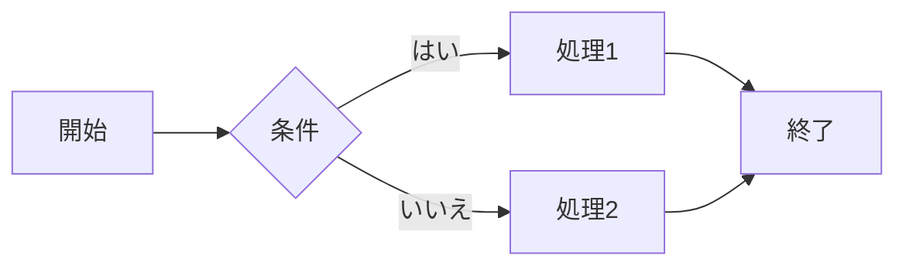
~~~~

## ノードの形
~~~~example
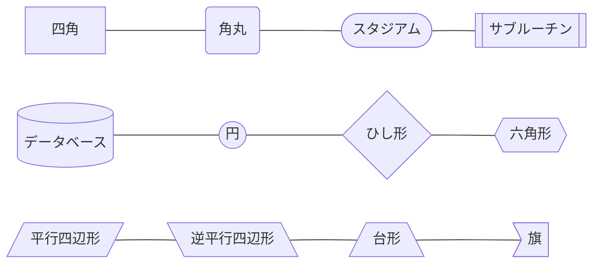
~~~~

## 矢印の種類
~~~~example
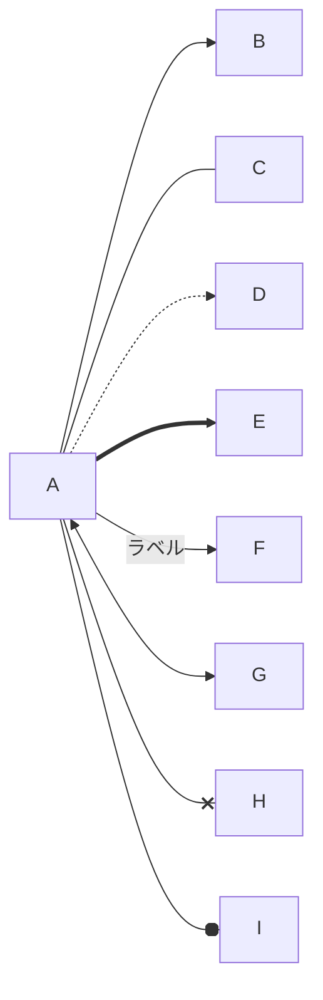
~~~~

## サブグラフ
~~~~example
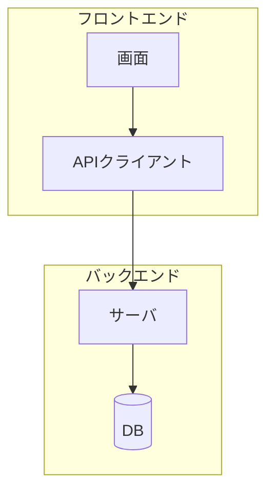
~~~~

## スタイル・クラス
~~~~example
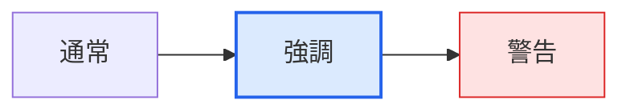
~~~~

## シーケンス図
`->>` 実線矢印、`-->>` 点線矢印、`activate` で実行中を表す。
~~~~example
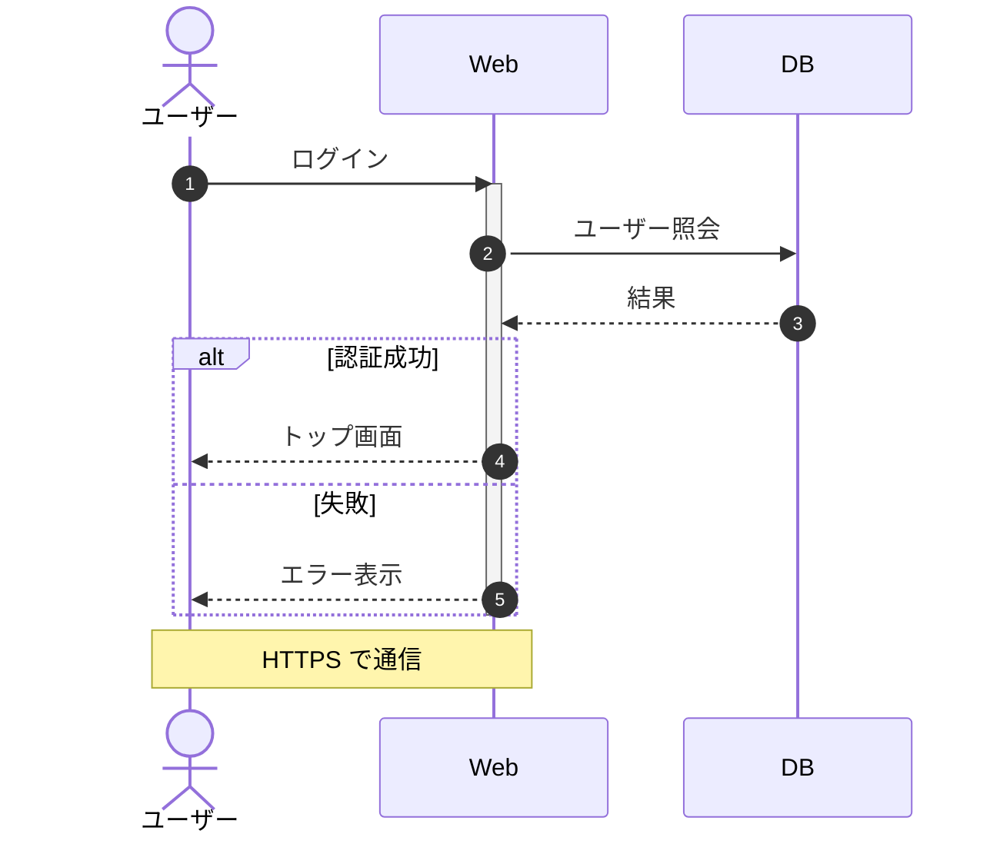
~~~~

## クラス図
~~~~example
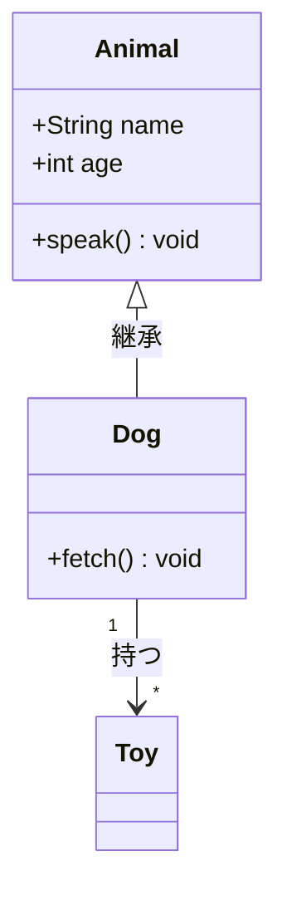
~~~~

## 状態遷移図
~~~~example
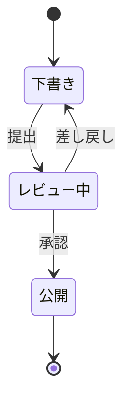
~~~~

## ER 図
`||--o{` は「1 対 0 以上」。`|o` 0か1、`||` ちょうど1、`}o` 0以上、`}|` 1以上。
~~~~example
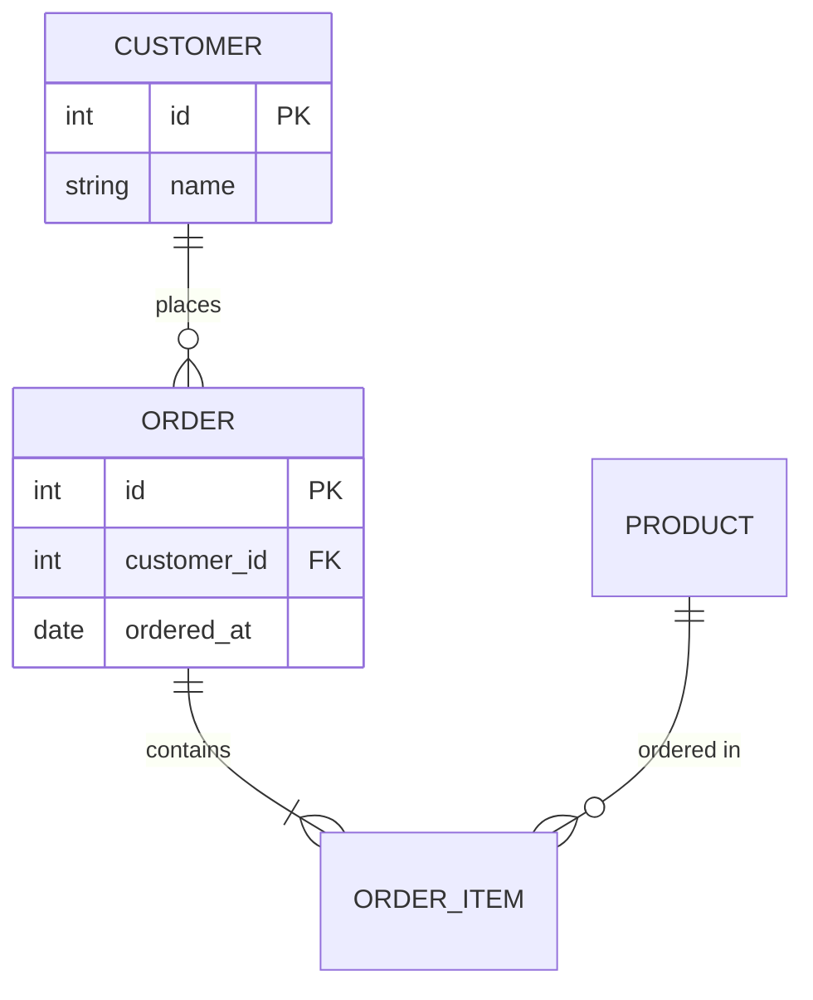
~~~~

## ガントチャート
~~~~example
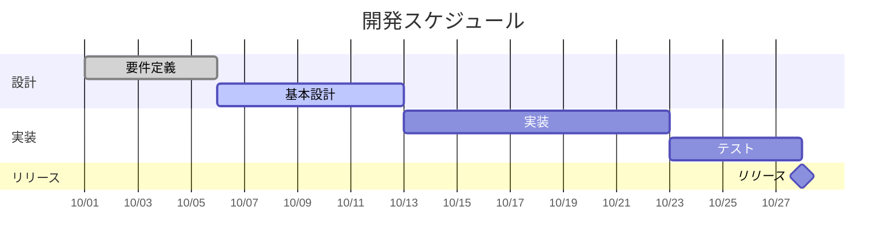
~~~~

## 円グラフ
~~~~example
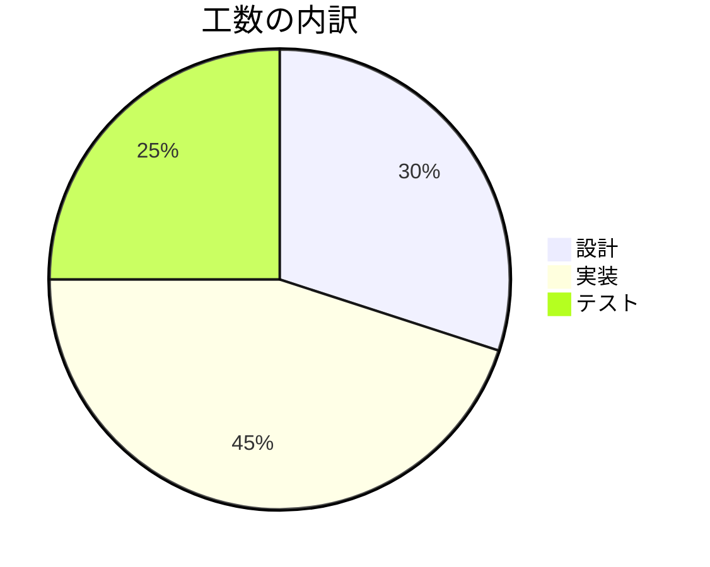
~~~~

## マインドマップ
字下げの深さで階層を表す。
~~~~example
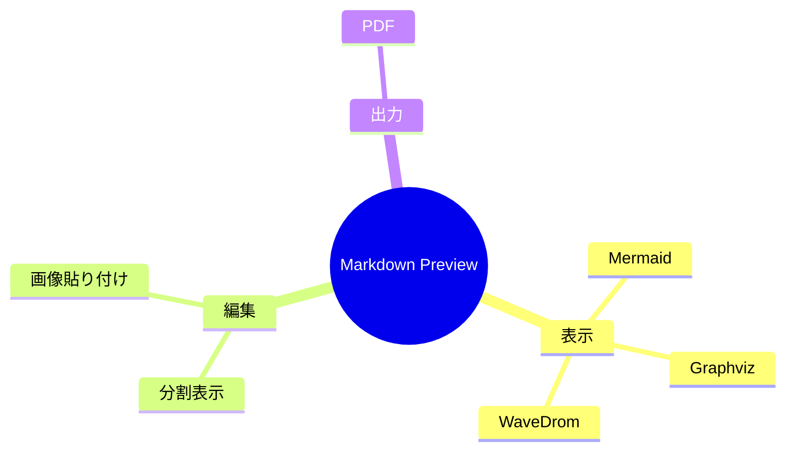
~~~~

## タイムライン
~~~~example
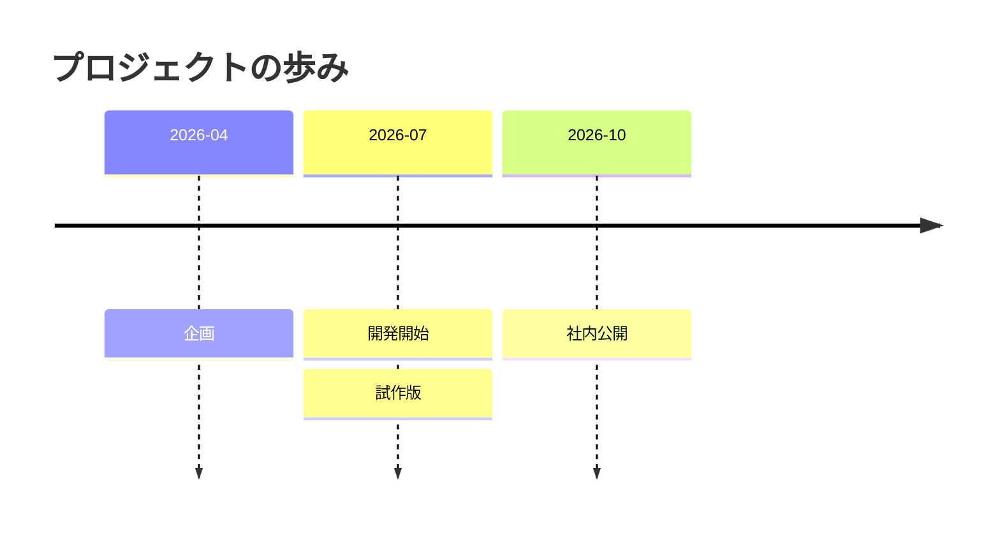
~~~~

## Git グラフ
~~~~example
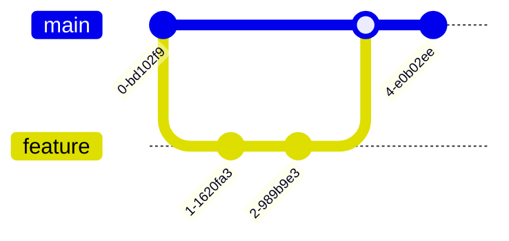
~~~~

## ユーザージャーニー
数字は満足度（1〜5）。
~~~~example
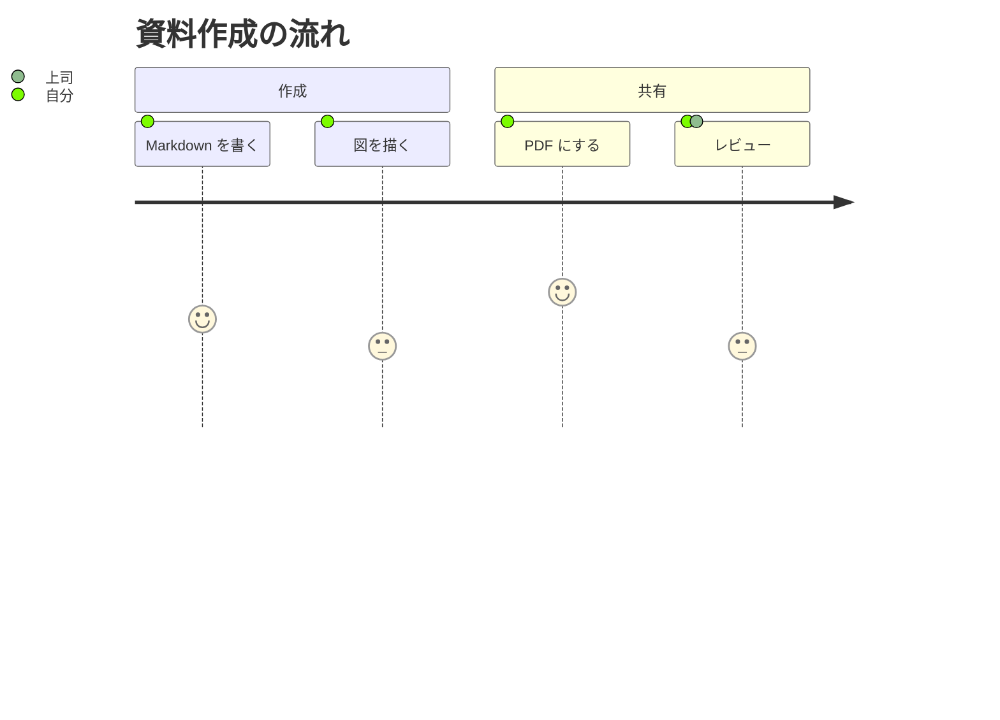
~~~~

## 4象限チャート
~~~~example
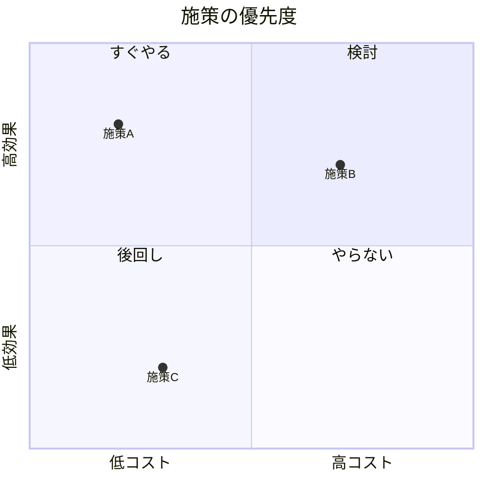
~~~~

## アーキテクチャ図
`group` で囲み、`service` で部品を置く。アイコンは `cloud` `database` `disk` `internet` `server`。線は `部品:辺 -- 辺:部品`（辺は `L` `R` `T` `B`）。
~~~~example

~~~~

## ブロック図
`columns` で 1 行に並べる数を決め、箱を左から順に置く。
~~~~example
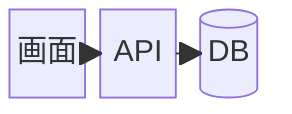
~~~~

## 棒グラフ・折れ線グラフ
`bar` が棒、`line` が折れ線。両方書くと重ねて出る。日本語のラベルは `"4月"` のように引用符で囲む。
~~~~example
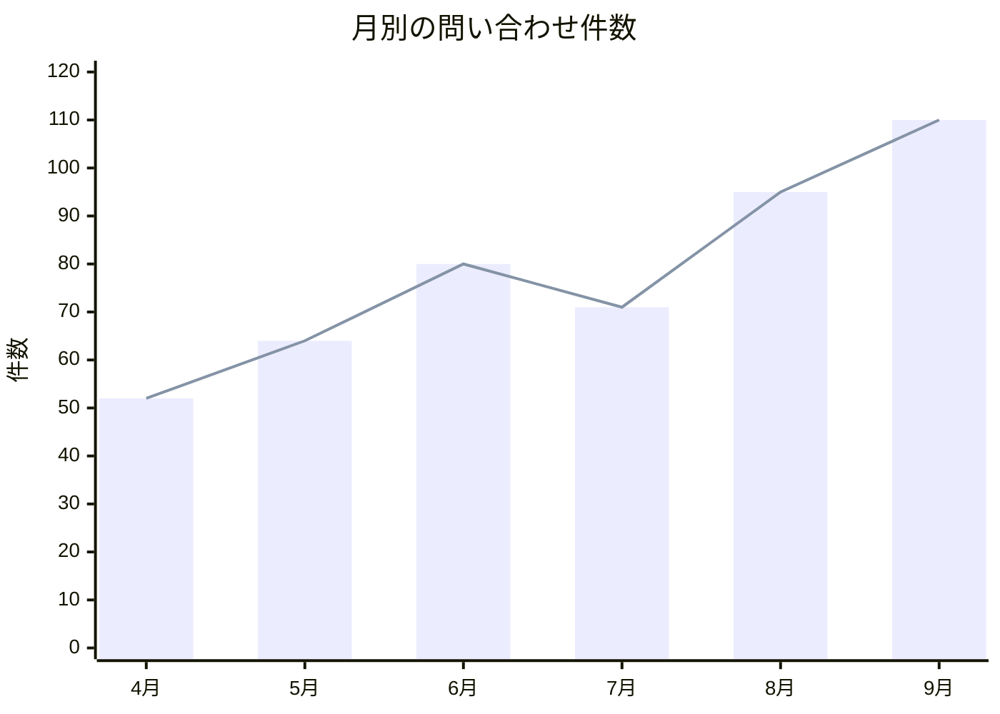
~~~~

## パケット図
`開始ビット-終了ビット: "名前"` を並べる。通信の電文やレコードの配置に使う。
~~~~example
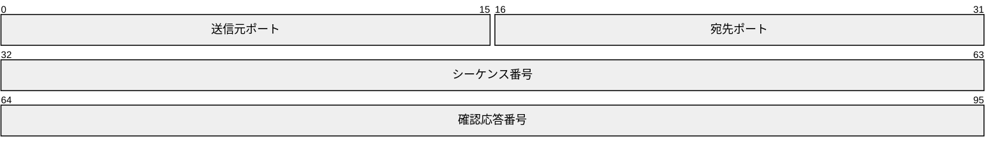
~~~~

## カンバン
列を書き、その下に字下げしてカードを書く。
~~~~example
```mermaid
kanban
  todo[未着手]
    t1[テーブル定義を書く]
  doing[作業中]
    t2[ER 図を描く]
  done[完了]
    t3[要件の確認]
```
~~~~

## レーダーチャート
`axis` で軸、`curve` で系列を書く。案の比較に使う。
~~~~example
```mermaid
radar-beta
  title 案の比較
  axis perf["性能"], ease["使いやすさ"], cost["費用"], ops["保守"]
  curve a["案A"]{4, 3, 2, 5}
  curve b["案B"]{2, 5, 4, 3}
  max 5
```
~~~~

## ツリーマップ
字下げで親子を書き、葉に値を付ける。面積が値に比例する。
~~~~example
```mermaid
treemap-beta
"工数"
    "開発"
        "画面": 30
        "API": 25
    "テスト": 20
    "運用": 15
```
~~~~

## 要件図
`requirement` で要件、`element` で部品を書き、`satisfies` などでつなぐ。名前は英数字で書く。
~~~~example
```mermaid
requirementDiagram
  requirement response {
    id: 1
    text: 3 秒以内に応答する
    risk: medium
    verifymethod: test
  }
  element api {
    type: service
  }
  api - satisfies -> response
```
~~~~

# C4 モデル（Mermaid） {#c4}

## 使用技術・書き方の調べ方
Mermaid 12 の C4 図（```` ```mermaid ```` の中で `C4Context` などから書き始める）。
- 書き方: [Mermaid の C4 図](https://mermaid.js.org/syntax/c4.html)（Mermaid 側でも試験的な機能という扱い）
- C4 モデルの考え方: [c4model.com](https://c4model.com/)
- Mermaid の C4 は線の経路や配置を指定できない。線を箱に重ねたくないときは [C4 モデル（Graphviz）](#c4-graphviz) を使う

## システムコンテキスト図
`Person` 利用者、`System` 対象システム、`System_Ext` 外部システム、`Rel(元, 先, "説明", "技術")` 関係。
~~~~example
```mermaid
C4Context
  title 受注システムのコンテキスト
  Person(customer, "顧客", "商品を注文する")
  System(shop, "受注システム", "注文を受け付ける")
  System_Ext(pay, "決済サービス", "クレジット決済")
  Rel(customer, shop, "注文する")
  Rel(shop, pay, "決済を依頼", "HTTPS")
```
~~~~

## コンテナ図
`System_Boundary` で囲み、`Container` / `ContainerDb` でアプリやDBを表す。
~~~~example
```mermaid
C4Container
  title 受注システムのコンテナ
  Person(customer, "顧客")
  System_Boundary(b, "受注システム") {
    Container(web, "Web アプリ", "TypeScript", "画面を提供")
    Container(api, "API", "Rust", "業務ロジック")
    ContainerDb(db, "DB", "PostgreSQL", "注文データ")
  }
  Rel(customer, web, "使う", "HTTPS")
  Rel(web, api, "呼び出す", "JSON")
  Rel(api, db, "読み書き", "SQL")
```
~~~~

## コンポーネント図
~~~~example
```mermaid
C4Component
  title API のコンポーネント
  Container(web, "Web アプリ", "TypeScript")
  Container_Boundary(api, "API") {
    Component(ctrl, "注文コントローラ", "axum", "HTTP を受ける")
    Component(svc, "注文サービス", "Rust", "業務ルール")
    Component(repo, "リポジトリ", "sqlx", "DB アクセス")
  }
  ContainerDb(db, "DB", "PostgreSQL")
  Rel(web, ctrl, "呼び出す")
  Rel(ctrl, svc, "使う")
  Rel(svc, repo, "使う")
  Rel(repo, db, "SQL")
```
~~~~

## 線の重なり・余白を調整する
Mermaid の C4 は自動レイアウトしない。要素は書いた順に横へ並ぶので、`UpdateLayoutConfig` で 1 行の個数を変え、`UpdateRelStyle` でラベル位置をずらす。
~~~~example
```mermaid
C4Context
  Person(user, "ユーザー")
  System_Ext(editor, "外部エディタ")
  System(app, "Markdown Preview")
  Rel(user, editor, "編集する")
  Rel(user, app, "プレビューする")
  Rel(editor, app, "保存を検知")
  UpdateRelStyle(user, app, $offsetX="-90", $offsetY="-10")
  UpdateLayoutConfig($c4ShapeInRow="2", $c4BoundaryInRow="1")
```
~~~~

## 要素の色を変える
~~~~example
```mermaid
C4Context
  System(a, "通常のシステム")
  System(b, "注目するシステム")
  UpdateElementStyle(b, $bgColor="#d1242f", $borderColor="#82071e")
  Rel(a, b, "連携")
```
~~~~

# Graphviz {#graphviz}

## 使用技術・書き方の調べ方
```` ```dot ```` / ```` ```graphviz ```` で囲んだ部分を [Graphviz](https://graphviz.org/) で描画している。Graphviz を WebAssembly にした [@viz-js/viz](https://github.com/mdaines/viz-js) 3 をアプリに同梱しているので、オフラインで動く。
- 書き方（DOT 言語）: [DOT Language](https://graphviz.org/doc/info/lang.html)
- 色・線・間隔などの属性: [Attributes](https://graphviz.org/doc/info/attrs.html)
- ノードの形: [Node Shapes](https://graphviz.org/doc/info/shapes.html)
- 作例: [Gallery](https://graphviz.org/gallery/)

## 有向グラフの基本
```` ```dot ```` または ```` ```graphviz ```` で囲む。`rankdir=LR` で左→右。
~~~~example
```dot
digraph G {
  rankdir=LR;
  開始 -> 処理 -> 終了;
  処理 -> エラー [label="失敗", color=red];
}
```
~~~~

## ノードの形と装飾
~~~~example
```dot
digraph G {
  node [fontname="sans-serif"];
  a [shape=box, style="rounded,filled", fillcolor="#dbeafe", label="角丸"];
  b [shape=ellipse, label="楕円"];
  c [shape=diamond, label="判定"];
  d [shape=cylinder, label="DB"];
  e [shape=note, label="メモ"];
  a -> b -> c -> d;
  c -> e [style=dashed];
}
```
~~~~

## クラスタ（グループ）
サブグラフ名を `cluster_` で始めると枠で囲まれる。
~~~~example
```dot
digraph G {
  compound=true;
  subgraph cluster_front { label="フロント"; style=rounded; ui; router; }
  subgraph cluster_back  { label="バック"; style=rounded; api; db [shape=cylinder]; }
  ui -> router -> api -> db;
}
```
~~~~

## 無向グラフ
~~~~example
```dot
graph G {
  layout=circo;
  A -- B -- C -- D -- A;
  A -- C;
}
```
~~~~

## レコード（表形式のノード）
~~~~example
```dot
digraph G {
  node [shape=record];
  user [label="{users|id: int\lname: text\l}"];
  order [label="{orders|id: int\luser_id: int\l}"];
  order -> user [label="user_id"];
}
```
~~~~

## ノードをクリックして関連を見る
Graphviz で描いた図（```` ```dot ```` ・ ```` ```c4 ```` と、ER 図・業務フロー・画面遷移図・マインドマップ）は、ノード（箱）を**クリックすると、そのノードにつながる線と相手のノードが光り**、ほかは薄くなる。向きは問わず、相手は 1 段だけ。
- 別のノード（光っている相手も）をクリックすると、そちらに切り替わる
- 光らせたノードを**もう一度クリック**すると、そのノードのリンク（`URL="#見出し"` など）へ移る。リンクが無ければ解除
- 図の余白をクリックするか **Esc** で解除。拡大ビューアの中でも同じように使える（ビューアでは Esc はビューアを閉じる）
- リンク先（`URL`）が同じノードは「同じもの」として**橙の枠**で示す（同じテーブルが図の別の場所にも出てくる、など）。線や相手までは広げない
- 光らせても図や文書は変わらず、PDF にも出ない。下の例で `B` → `A` → `A` の順に押してみる
~~~~example
```dot
digraph G {
  node [shape=box, style="rounded,filled", fillcolor="#ffffff"];
  subgraph cluster_x { label="X";
    A [label="A（リンクあり）", URL="#graphviz", fillcolor="#fff3b0"];
    B;
  }
  C; D; D2;
  A -> B [label="a-b"];
  B -> C [label="b-c"];
  D -> D2;
}
```
~~~~

# C4 モデル（Graphviz） {#c4-graphviz}

## 使用技術・書き方の調べ方
```` ```c4 ```` で囲むと、C4-PlantUML / Mermaid と同じ書き方の C4 図を、このアプリが Graphviz の DOT に変換して描く。Mermaid の C4 と違い、線は箱を避けて通り、`Rel_R` や `Lay_D` で配置を指定できる。Mermaid の C4 のソースは、```` ```mermaid ```` を ```` ```c4 ```` に変えるだけで描ける（`UpdateRelStyle` / `UpdateLayoutConfig` は無視される）。
- 書き方の元: [C4-PlantUML](https://github.com/plantuml-stdlib/C4-PlantUML)（このアプリが対応しているのは下の一覧だけ）
- C4 モデルの考え方: [c4model.com](https://c4model.com/)
- `dot:` で指定する属性: [Graphviz の属性一覧](https://graphviz.org/doc/info/attrs.html)
- 要素: `Person` `Person_Ext` `System` `System_Ext` `SystemDb` `SystemDb_Ext` `Container` `Container_Ext` `ContainerDb` `ContainerDb_Ext` `Component` `Component_Ext` `ComponentDb` `ComponentDb_Ext`
- 囲み: `Boundary` `System_Boundary` `Container_Boundary` `Enterprise_Boundary`（`{` `}` で囲む。入れ子可）
- 関係: `Rel` `Rel_D` `Rel_U` `Rel_R` `Rel_L` `BiRel`（`BiRel_D` なども可）
- 配置だけ: `Lay_D` `Lay_U` `Lay_R` `Lay_L`
- 全体: `title` `LAYOUT_TOP_DOWN()` `LAYOUT_LEFT_RIGHT()` `UpdateElementStyle` `dot:`
- 自由配置: `Pos(id, x, y)`（このアプリ独自。1 つでも書くと、その位置に置いて線だけ自動で引く。図のビルダーで箱をドラッグすると書かれる。Mermaid には書き出されない）
- 文字列の中の `\n` で改行できる。要素の説明は長いと自動で折り返す
- `Person` / `Person_Ext` は人のアイコン付きの箱になる
- コードを書かずに作りたいときは、メニューの **挿入 → 図…**（Ctrl+Shift+D）の図のビルダーが使える（線をクリックして向きを変えられる）

## コンテキスト図
`Person(id, "名前", "説明")`、`System(id, "名前", "説明")`、`Rel(元, 先, "説明", "技術")`。
~~~~example
```c4
title 受注システムのコンテキスト
Person(customer, "顧客", "商品を注文する")
System(shop, "受注システム", "注文を受け付けて在庫を引き当てる")
System_Ext(pay, "決済サービス", "クレジット決済")
Rel(customer, shop, "注文する")
Rel(shop, pay, "決済を依頼", "HTTPS")
```
~~~~

## コンテナ図（囲み）
`System_Boundary(id, "名前") { … }` で囲む。`Container(id, "名前", "技術", "説明")`、`ContainerDb` は円柱になる。
~~~~example
```c4
title 受注システムのコンテナ
Person(customer, "顧客")
System_Boundary(b, "受注システム") {
  Container(web, "Web アプリ", "TypeScript", "画面を提供")
  Container(api, "API", "Rust", "業務ロジック")
  ContainerDb(db, "DB", "PostgreSQL", "注文データ")
}
Rel(customer, web, "使う", "HTTPS")
Rel(web, api, "呼び出す", "JSON")
Rel(api, db, "読み書き", "SQL")
```
~~~~

## 配置を決める（Rel_R / Lay_D）
`Rel_R(a, b)` は b を a の右に、`Rel_L` は左、`Rel_U` は上、`Rel_D` は下に置く。`Lay_*` は線を引かずに位置だけ決める。囲み（Boundary）の id を `Rel` に書くと、線は枠で止まる。
~~~~example
```c4
Person(user, "利用者")
Container_Boundary(mon, "稼働モニタ") {
  Container(spa, "SPA", "TypeScript")
  Container(api, "API", "Rust")
}
System_Ext(mail, "メール")
Rel(user, spa, "見る")
Rel_R(spa, api, "呼ぶ")
Rel_R(api, mail, "通知")
Lay_D(user, mon)
```
~~~~

## 線の交差を減らすコツ
線が交差するのは、ひとつの要素から「囲みの中（DB・ファイル）」と「外部システム」の両方へ線が出ていて、相手が同じ段に並ぶとき。次の順に試す。
- 囲みの中の相手への線を `Rel_U` にして上の段へ、外部システムへの線は `Rel` のまま下の段へ分ける（矢印の向きは変わらず、置く場所だけが上になる）
- 複数の要素から線が集まる相手（共通の DB など）は、線を出す要素たちの真上か真下に来るよう `Rel_U` / `Rel_D` をそろえる
- 横に並べたい相手は `Rel_R` / `Rel_L`、線を引かずに位置だけ決めたいときは `Lay_*` を使う
- それでも詰まって見えるときは `dot: nodesep=1.0` / `dot: ranksep=1.0` で間隔を広げる
下の例は、DB への 2 本を `Rel_U` にしたもの。`Rel` に戻すと DB と外部システムが同じ段に並び、線が交差する。
~~~~example
```c4
Container_Boundary(sv, "サーバ") {
  Container(web, "Web", "Django")
  Container(batch, "バッチ", "cron")
  ContainerDb(db, "DB", "PostgreSQL")
}
System_Ext(sql, "SQL Server")
System_Ext(plc, "設備PLC")
System_Ext(mail, "SMTP")
Rel_U(web, db, "読み書き")
Rel_U(batch, db, "書き込み")
Rel(web, sql, "読み書き")
Rel(batch, sql, "読む")
Rel(batch, plc, "読み出し")
Rel(batch, mail, "通知")
```
~~~~

## 横向きにする
`LAYOUT_LEFT_RIGHT()` で左→右に並べる（このとき `Rel_D` / `Rel_U` が同じ列での上下になる）。
~~~~example
```c4
LAYOUT_LEFT_RIGHT()
Person(u, "ユーザー")
System(app, "アプリ", "1行目\n2行目")
SystemDb_Ext(db, "外部DB")
Rel(u, app, "使う")
Rel(app, db, "保存")
```
~~~~

## 線を直角にする・間隔を広げる（dot:）
`dot:` の後ろは DOT の文としてそのまま入る。`splines=ortho` で直角の線、`nodesep` / `ranksep` で横・縦の間隔（インチ）。直角の線ではラベルが線から離れたり消えたりすることがあるので、ラベルが多い図は `splines=polyline`（折れ線）が見やすい。
~~~~example
```c4
dot: splines=ortho
dot: nodesep=1.0
Container(gw, "Gateway", "nginx")
Container(a, "注文", "Go")
Container(b, "在庫", "Go")
Container(c, "配送", "Go")
Rel(gw, a)
Rel(gw, b)
Rel(gw, c)
```
~~~~

## 要素の色を変える
~~~~example
```c4
System(a, "通常のシステム")
System(b, "注目するシステム")
UpdateElementStyle(b, $bgColor="#d1242f", $borderColor="#82071e")
Rel_R(a, b, "連携")
```
~~~~

# WaveDrom {#wavedrom}

## 使用技術・書き方の調べ方
```` ```wavedrom ```` で囲んだ部分を [WaveDrom](https://wavedrom.com/) 3 で描画している。中身は JSON だが、このアプリでは JSON5（キーの引用符省略・末尾のカンマ・コメント可）で書ける。
- 書き方: [WaveDrom Tutorial](https://wavedrom.com/tutorial.html)

## 信号の基本
```` ```wavedrom ```` で囲み JSON（JSON5）で書く。1文字が1周期。
`p` クロック、`0` `1` レベル、`x` 不定、`=` `2`〜`9` データ（色違い）、`.` 直前を継続、`|` 省略。
~~~~example
```wavedrom
{ signal: [
  { name: "clk",  wave: "p......." },
  { name: "rst",  wave: "10......" },
  { name: "data", wave: "x.=.=.x.", data: ["A", "B"] },
  { name: "valid", wave: "0.1...0." }
]}
```
~~~~

## グループと区切り
配列で囲むとグループになる。`{}` は空行。
~~~~example
```wavedrom
{ signal: [
  { name: "clk", wave: "p....." },
  {},
  ["送信",
    { name: "tx",  wave: "x345x.", data: ["a", "b", "c"] },
    { name: "req", wave: "01..0." }
  ],
  ["受信",
    { name: "ack", wave: "0.1..0" }
  ]
]}
```
~~~~

## 矢印（エッジ）
`node` に付けた文字同士を `edge` でつなぐ。
~~~~example
```wavedrom
{ signal: [
  { name: "req", wave: "01..0.", node: ".a..." },
  { name: "ack", wave: "0.1..0", node: "..b.." }
],
  edge: ["a~>b 応答"]
}
```
~~~~

## レジスタ図
~~~~example
```wavedrom
{ reg: [
  { bits: 7, name: "opcode", attr: "OP" },
  { bits: 5, name: "rd" },
  { bits: 3, name: "funct3" },
  { bits: 5, name: "rs1" },
  { bits: 12, name: "imm" }
]}
```
~~~~

# 数式（KaTeX） {#math}

## 使用技術・書き方の調べ方
**ツール → 設定… → オプション機能** の「数式（KaTeX）」をオンにすると使える（オフのあいだは書いたままの文字やコードとして出る）。[KaTeX](https://katex.org/) 0.16 で描画している（アプリに同梱。オフラインで動く）。書き方は GitHub と同じ。
- 使える命令: [KaTeX の対応一覧](https://katex.org/docs/supported.html)
- LaTeX の数式の書き方全般: [Wikibooks: LaTeX/Mathematics](https://en.wikibooks.org/wiki/LaTeX/Mathematics)

## 文中の数式
`$` で挟む。開く `$` の直後と閉じる `$` の直前に空白を入れない。「$100 と $200」のような金額は数式にならない。`$` そのものを書きたいときは `\$`。
~~~~example
円の面積は $S = \pi r^2$、二次方程式の解は $x = \frac{-b \pm \sqrt{b^2 - 4ac}}{2a}$ です。
~~~~

## 数式のブロック
`$$` で挟むか、```` ```math ```` で囲む。中央に大きく出る。
~~~~example
$$
\sum_{k=1}^{n} k = \frac{n(n+1)}{2}
$$

```math
\begin{aligned}
\text{粗利} &= \text{売上} - \text{原価} \\
\text{粗利率} &= \frac{\text{粗利}}{\text{売上}} \times 100
\end{aligned}
```
~~~~

## 行列・場合分け
~~~~example
$$
A = \begin{pmatrix} 1 & 2 \\ 3 & 4 \end{pmatrix}, \quad
f(x) = \begin{cases} x & (x \ge 0) \\ -x & (x < 0) \end{cases}
$$
~~~~

# ER 図（erd） {#erd}

## 使用技術・書き方の調べ方
**ツール → 設定… → オプション機能** の「ER 図（テーブル定義の表から）」をオンにすると使える。このアプリ独自の書き方で、```` ```erd ```` の中に書いたテーブル定義の表を [Graphviz](https://graphviz.org/) で ER 図にする。オフのあいだは表のソースのまま出るので、設計書のテーブル定義をそのまま図にできる。

## 基本の書き方
`## 物理名 論理名` でテーブルを始め、その下に列の表を書く。表の見出しで役割を決める（順番は自由）。
- **列**（列名・カラム・項目・物理名・name）: 列の名前。見つからなければ 1 列目
- **型**（データ型・type）、**キー**（制約・key）、**説明**（備考・論理名・note）: 無くてもよい
- キーに `PK` を書くと太字と下線、`FK 表.列` を書くと斜体になり、参照先の列へ線を引く（`FK 表` だけなら参照先の PK）。`UK` は一意
- 線は参照される側（1）が縦棒、参照する側（多）がカラスの足
~~~~example
```erd
## customers 顧客
| 列 | 型 | キー | 説明 |
|---|---|---|---|
| id | int | PK | |
| name | varchar(100) | | 氏名 |
| email | varchar(255) | UK | |

## orders 注文
| 列 | 型 | キー | 説明 |
|---|---|---|---|
| id | int | PK | |
| customer_id | int | FK customers.id | 注文者 |
| ordered_at | datetime | | 注文日時 |

## order_items 注文明細
| 列 | 型 | キー | 説明 |
|---|---|---|---|
| order_id | int | PK, FK orders.id | |
| line_no | int | PK | 行番号 |
| product_id | int | FK products.id | |
| quantity | int | | 数量 |

## products 商品
| 列 | 型 | キー | 説明 |
|---|---|---|---|
| id | int | PK | |
| name | varchar(100) | | 商品名 |
| price | int | | 単価 |
```
~~~~

## タイトル・コメント
`title` で図の上に題名を出す。`%%` で始まる行はコメント。書き方を間違えると「N 行目: …」と場所を知らせる。
~~~~example
```erd
title 部署と社員
%% 自己参照（上司）も書ける
## depts 部署
| 列 | キー |
|---|---|
| id | PK |
| name | |

## employees 社員
| 列 | キー |
|---|---|
| id | PK |
| dept_id | FK depts.id |
| boss_id | FK employees.id |
```
~~~~

# マインドマップ（markmap） {#markmap}

## 使用技術・書き方の調べ方
**ツール → 設定… → オプション機能** の「マインドマップ（見出し・箇条書きから）」をオンにすると使える。```` ```markmap ```` の中に普通の Markdown の見出しと箇条書きを書くと、左から右へ枝分かれするマインドマップになる。書き方は [markmap](https://markmap.js.org/) と同じで、描画はこのアプリが [Graphviz](https://graphviz.org/) で行う。オフのあいだは箇条書きのソースのまま出るので、そのままでも読める。

## 見出しと箇条書き
`#` の数と箇条書きの字下げで親子が決まる。いちばん上の見出しが中心になり、枝ごとに色が変わる。`**太字**` や `` `コード` `` の飾りは外して出す。
~~~~example
```markmap
# 新システム導入
## 目的
- 入力の手間を減らす
- 集計を自動にする
## 体制
- 推進: 情報システム課
- 利用: 営業部
  - 東京
  - 大阪
## スケジュール
1. 要件定義
2. 開発
3. 移行
```
~~~~

## 中心が複数のとき
いちばん上の項目が複数あるときは、`title` に書いた言葉を中心にする（無ければ点）。
~~~~example
```markmap
title 課題
- 品質
  - テスト不足
- 費用
  - 外注費
- 期間
```
~~~~

# 業務フロー（flow） {#flow}

## 使用技術・書き方の調べ方
**ツール → 設定… → オプション機能** の「業務フロー（担当ごとのレーン）」をオンにすると使える。このアプリ独自の書き方で、```` ```flow ```` の中に「担当: 処理」を上から順に書くと、担当ごとの縦の帯（レーン）に分けた業務フロー図を [Graphviz](https://graphviz.org/) で描く。

## 基本の書き方
- 1 行に `担当: 処理`。上から順に矢印でつながる。担当はレーンになり、出てきた順に左から並ぶ（`lanes: 顧客, 営業, 倉庫` で順番を決めてもよい）
- 処理が `開始` / `終了` なら端の形。`終了` の後には矢印を引かない
- 処理の末尾が `?` なら判断（ひし形）。次の行から字下げして `ラベル -> @行き先` で分かれ道を書く。行き先を空にする（`いいえ ->`）と次の行へ進む
- 行き先にする処理には、末尾に `@名前` を付ける。`\n` で改行
~~~~example
```flow
title 受注の流れ
顧客: 開始
顧客: 注文する
営業: 在庫を確認する
営業: 在庫はある?
  はい -> @出荷
  いいえ ->
営業: 欠品を\n連絡する
顧客: 終了
倉庫: 出荷する @出荷
顧客: 受け取る
```
~~~~

## 差し戻し（前に戻る）
`@名前` を付けた前の処理を行き先にすると、戻りの矢印になる。
~~~~example
```flow
lanes: 申請者, 上長
申請者: 開始
申請者: 申請書を出す @申請
上長: 内容は正しい?
  承認 ->
  差し戻し -> @申請
上長: 承認する
申請者: 終了
```
~~~~

# 画面遷移図（screen） {#screen}

## 使用技術・書き方の調べ方
**ツール → 設定… → オプション機能** の「画面遷移図」をオンにすると使える。このアプリ独自の書き方で、```` ```screen ```` の中に画面のつながりを書くと、画面をウィンドウの形の箱にして [Graphviz](https://graphviz.org/) で描く。

## 基本の書き方
- `画面A -> 画面B : 操作` で遷移。`: 操作` は省いてよい。`<->` は行き来
- 矢印の無い `画面 : 説明` は、画面の箱に説明を添える。名前だけの行は、つながりの無い画面として置く
- `title` で題名、`direction TB` で上から下へ（既定は左から右）
~~~~example
```screen
title 会員登録
ログイン -> 会員登録 : 新規登録
会員登録 -> 確認 : 確認する
確認 -> 会員登録 : 戻る
確認 -> 完了 : 登録する
完了 <-> マイページ : 開く / 戻る
確認 : 入力内容を表示
```
~~~~

# AA の図（svgbob） {#svgbob}

## 使用技術・書き方の調べ方
**ツール → 設定… → オプション機能** の「AA を図に（svgbob）」をオンにすると使える。```` ```bob ```` の中に罫線や記号で描いた図（ASCII アート）を、[svgbob](https://github.com/ivanceras/svgbob) で線と矢印のきれいな図にする。オフのあいだは AA のまま出るので、そのままでも読める。
- 書き方の例: [svgbob の例](https://ivanceras.github.io/svgbob-editor/)

## 箱と矢印
`+` `-` `|` で角張った箱、`.` `'` で角の丸い箱になる。`>` `<` `^` `v` が矢印の先。日本語は 1 文字を半角 2 文字分として数える。
~~~~example
```bob
+--------+      +----------+      .---------.
| 画面   |----->|  API     |----->|  DB     |
+--------+      +----+-----+      '---------'
                     |
                     v
                +----------+
                | 外部連携 |
                +----------+
```
~~~~

## 点線・丸・斜めの線
`:` で縦の点線、`o` で白丸、`*` で黒丸、`/` `\` で斜めの線。
~~~~example
```bob
   .---.          .---.
  / 端 \  o-----*| 主 |
  \    /   :     '---'
   '--'    :
         .---.
         | 予|
         '---'
```
~~~~

# このアプリの使い方 {#app}

## キーボードショートカット
~~~~example
| キー | 動作 |
|---|---|
| Ctrl+N / Ctrl+O | 新しいタブ（無題） / 開く（複数選択可） |
| Ctrl+W | 表示中のタブを閉じる |
| Ctrl+Tab / Ctrl+Shift+Tab | 次 / 前のタブ（Ctrl+PageDown / PageUp も可） |
| Ctrl+S / Ctrl+Shift+S | 保存 / 名前を付けて保存 |
| Ctrl+P | PDF プレビュー（確認してから「保存」） |
| Ctrl+Shift+D | 図のビルダー（C4 図をフォームで作る・カーソル位置の図を直す）。カーソルが画像の行なら画像の注釈 |
| Ctrl+Shift+A | 画像の注釈（カーソル位置の画像に矢印・テキスト・枠・番号を重ねる） |
| Ctrl+Shift+C | 開いているファイルのパスをコピー |
| Ctrl+1 / 2 / 3 | 編集 / 分割 / プレビュー（編集から切り替えると編集位置を表示・色付け。分割表示ではカーソルのある箇所を常に色付けし、プレビューの文をクリックするとエディタのカーソルがそこへ移る。色は **ツール → 設定…** で変更） |
| Ctrl+ホイール | マウスの下のペインを拡大縮小 |
| Ctrl+＋ / Ctrl+− / Ctrl+0 | 拡大 / 縮小 / 100% |
| プレビューの図・画像をクリック | 拡大ビューアで開く（ホイールで拡大縮小・ドラッグで移動・Esc で閉じる） |
| Ctrl+F / Ctrl+H（エディタ） | 検索 / 置換 |
| Ctrl+D / Ctrl+Shift+L（エディタ） | 次の一致を選択に追加 / すべての一致を選択（下の「まとめて編集するコツ」） |
| Tab / Shift+Tab（エディタ） | タブ文字を入力（範囲選択中と、`*` `-` `1.` などの箇条書きの行では、記号ごと行を字下げ） / 字下げを戻す |
| マウスで選択 / 右クリック（エディタ） | 選んだ文字を自動でコピー（プレビューでも） / カーソル位置に貼り付け。Tera Term と同じ操作。**ツール → 設定…** でオフにできる |
| Ctrl+, | 設定（テーマ・編集位置の色付け・更新） |
| F1 | このヘルプ |
| Alt / F10 | メニューバーに移る（Alt+F でファイル、Alt+E で編集… のメニューを直接開く） |
| F5 | ファイルを再読み込み |
~~~~

テーマ（自動 / ライト / ダーク）は **表示 → テーマ** で切り替える。文書の装いは **表示 → 文書スタイル** で「GitHub」と「設計メモ」（BIZ UDPゴシック・青緑の見出し線・白い面の表）から選べる。文書スタイルはプレビューと PDF に効く（ヘルプは GitHub のまま）。開く・保存・設定などの操作は、ウィンドウ上端のメニューバーにまとまっている。

## まとめて編集するコツ（マルチカーソル）
~~~~example
カーソルを複数置くと、打った文字や改行がすべての場所に同時に入る（VS Code と同じ操作）。

| 操作 | 動作 |
|---|---|
| Ctrl+D | 選択中の文字列の、次の一致を選択に追加（選択がなければカーソル位置の単語を選ぶ） |
| Ctrl+Shift+L / Ctrl+F2 | 選択中の文字列（選択がなければカーソル位置の単語）の一致をすべて選択 |
| Alt+クリック / Ctrl+クリック | クリックした場所にカーソルを追加 |
| Ctrl+Alt+↑ / ↓ | 上 / 下の行にカーソルを追加 |
| Shift+Alt+ドラッグ | 矩形（四角い範囲）で選択 |
| Shift+Alt+I | 選択した各行の末尾にカーソルを置く |
| Ctrl+U | 最後に追加したカーソルを取り消す |
| Esc | カーソルを 1 つに戻す |

**例: 1 行に並んだ `;` の後ろで、まとめて改行する**

1. `;` を 1 つ選択して **Ctrl+Shift+L**（すべての `;` が選択される）
2. **→** キーで各選択の後ろへ移り、**Enter**

**置換でもできる**: **Ctrl+H** で検索に `;`、置換に `;\n` と入れて **すべて置換**（置換欄の `\n` は改行、`\t` はタブになる）。「正規表現」をオンにすると `$1` などで一致した部分を使える。
~~~~

## 目次（プレビューモード）
~~~~example
- プレビューモード（Ctrl+3）のとき、プレビューの左に見出し（`#`〜`###`）の一覧が出る
- スクロールしても残り、**読んでいる章が色付け**される。目次の章をクリックするとその章へ移る
- `###` は、読んでいる `##` の下だけ開く（長い索引があっても目次が短いまま）
- **表示 → 目次（プレビュー）** で出す・隠す。次回の起動にも引き継ぐ。見出しが 2 つ未満の文書では出ない。PDF には出ない
~~~~

## タブで複数のファイルを開く
~~~~example
- 開いたファイルはタブで並ぶ（メニューバーとツールバーの下）。クリックで切り替え、**×** か**中クリック**で閉じる
- すでに開いているファイルを開くと、そのタブに切り替わる
- ツールバー左の**パス表示**に、今のタブのファイルのフルパスが出る。クリックするとパスをコピー（**Ctrl+Shift+C** と同じ）
- 編集内容・カーソル・元に戻す（Ctrl+Z）の履歴はタブごとに残る。未保存のタブには **•** が付く
- 未保存のタブを閉じるときや、未保存のタブがある状態でウィンドウを閉じるときは確認が出る
- 次に起動したときは、前回開いていたタブを開き直す（未保存の変更は持ち越さない）
~~~~

## 図のビルダー（C4 をフォームで作る・直す）
メニューの **挿入 → 図…**（Ctrl+Shift+D）で開く。コードを書かずに、表に入力して C4 図を作れる。右側にプレビューと生成コードが出る。
- **カーソルが ```` ```c4 ```` / ```` ```mermaid ````（C4）の図の中にあるとき**は、その図を読み込んで編集し、**置き換え**で元の図を書き換える。図の外なら新しい図をカーソル位置に**挿入**する
- **線の位置を変える**: プレビューの線をクリックするか、関係の行を選ぶと、右下に「選んでいる線」が出る。**↑↓←→** で相手を置く側を変えられる（`Rel_U` / `Rel_D` / `Rel_L` / `Rel_R`。**自動**は `Rel`）
- 種類を「配置だけ（線なし）」にすると `Lay_*` になる（線を引かずに位置だけ決める。```` ```c4 ```` のみ）
- **ドラッグで配置する**（```` ```c4 ```` のとき。プレビューの上の「ドラッグで: 移動 / 線を引く」で切り替え）
  - 移動・**配置が自動**のとき: 箱を別の箱の**上下左右に重ねて落とす**と、その側に置く（関係があればその向き `Rel_*` を変え、なければ配置だけの `Lay_*` を足す）
  - 移動・**配置が自由**のとき（「全体」の「配置」を「自由」に）: 箱を**落とした位置に固定**する（`Pos(id, x, y)`）。囲みをドラッグすると中の要素もまとめて動く。線は箱を避けて自動で引く
  - 線を引く: 箱から別の箱へドラッグすると、線（関係）を追加する
  - 表の行は左端の **⠿** をドラッグして並べ替えられる。囲みの行の真ん中に落とすと、その囲みの中に入る
- 出力を ```` ```mermaid ```` にすると、ラベル位置（`UpdateRelStyle` の `$offsetX` / `$offsetY`）を ←→↑↓ で 10 ずつ動かせる。「1 行の個数」は `UpdateLayoutConfig($c4ShapeInRow)`
- 要素の id を変えると、関係の元・先も一緒に変わる。要素を消すと、その要素の関係も消える。↑↓ で並び順（Mermaid では配置に効く）を変えられる
- 表で扱わない行（コメントなど）は消さずに末尾に残す

## オプション機能（必要なものだけオンにする）
**ツール → 設定…** の「オプション機能」で、使いたいものだけをオンにする。既定はすべてオフ。

**表の ○ / △ / ✕ を色付け**: 表のセルの中身が判定の語だけなら、色付きの太字にする。文の一部（「なし（対象外）」など）には付けない。見出し行も対象外。
~~~~example
| 項目 | 今 | 改修後 |
|---|---|---|
| 主キー | なし | あり |
| インデックス | △ | ○ |
| 自動テスト | NG | OK |
~~~~

| 色 | 語 |
|---|---|
| 緑（設計メモでは青緑） | ○ ◯ 〇 ✓ ✔ あり 有 OK 可 |
| 黄 | △ 一部 |
| 赤 | ✕ × ✗ ✘ なし 無 NG 不可 |

## 画像の貼り付け
~~~~example
1. スクリーンショットなどをクリップボードにコピー
2. エディタ（編集 / 分割モード）で **Ctrl+V**
3. `` が挿入される（md が `設計書.md` のとき）
4. **Ctrl+S** で保存すると、md と同じフォルダの `設計書.assets/` に画像が書き出される（md ごとに別のフォルダになる）
5. まだ保存していない無題の文書では仮に `untitled.assets/` と入り、初めて保存したときに保存した名前のフォルダへ書き換わる
~~~~

## 画像に注釈を付ける（矢印・コメント）
画面キャプチャなどに、矢印・赤字のコメント・四角の枠・番号マーカー（① ② ③）を重ねられる。Excel で図形やテキストボックスを置くのと同じ使い方。
- **開き方**: プレビューの画像を**右クリック →「注釈を編集…」**、またはカーソルを画像の行に置いて **Ctrl+Shift+A**（**図** / Ctrl+Shift+D でも開く）。貼り付けたばかりの画像や、まだ保存していない md でもそのまま注釈できる（ファイルにある画像を無題の md で使うときだけ、先に保存する）
- **描き方**: 右側で道具を選ぶ。**矢印**・**枠**はドラッグ、**テキスト**・**番号**（番号マーカー）はクリックで置く（1, 2, 3… と続く）。テキストは「背景を白で塗る」で読みやすくできる。**選択**で図形をドラッグして移動、矢印の端・枠の角の ● で形を変える。色・太さ・文字の大きさは右の欄で変える
- **Delete** で削除、**Ctrl+Z** で元に戻す、矢印キーで 1px（Shift で 10px）動かす
- **適用**すると md が書き換わり、md を**保存したとき**に注釈を描き込んだ画像（`form.png` なら隣に `form.annotated.png`。同じ画像に別の注釈を付けると `form.annotated-2.png`…）が書き出される。保存せずに閉じれば何も残らない。md を次の形に書き換える。GitHub など他のビューアでは描き込んだ画像が見え、このアプリでは元画像の上に描き直すので、あとから何度でも直せる
- 注釈を全部消して適用すると、元の画像の参照に戻る（書き出した画像は残る）
- 番号マーカーと要望の表は自動では対応しないので、下の例のように表を書いておく
- 注釈は画像と一緒に拡大縮小するので、ズームや PDF でもずれない
~~~~example

<!-- annotate {"src":"form.png","size":[1280,720],"items":[{"t":"arrow","from":[900,140],"to":[620,150]},{"t":"text","at":[910,130],"text":"調理日は自動で今日の日付に","size":28}]} -->

| No. | 要望 |
|---|---|
| ① | 調理日は自動で今日の日付が入るようにしたい |
| ② | ハシは入力の流れ的に下の方に入力欄を移動したい |
~~~~

## 図や画像を拡大して見る
~~~~example
1. プレビューの図や画像を**クリック**（または右クリック →「**拡大して見る**」）
2. ウィンドウいっぱいに、全体が収まる大きさで表示される
3. **ホイール**でマウスの位置を中心に拡大縮小、**ドラッグ**で移動。`0` で全体表示、`1` で実寸
4. **Esc**、右上の **×**、図の外をクリックで閉じる

- Mermaid などの図は拡大しても文字がぼけない
- 注釈を付けた画像は、注釈を重ねたまま拡大する
- 図の中のリンクは、ドラッグせずにクリックすると移る（本文の中へのリンクと別の .md は、ビューアを閉じてから移る）
- Graphviz の図は、ノードをクリックすると関連が光る（「Graphviz」の「ノードをクリックして関連を見る」）
- 表示を重ねるだけなので、MD・PDF・エクスポートには影響しない
~~~~

## PDF に出力する
~~~~example
1. **ファイル → PDF に出力…** か **Ctrl+P** でプレビューを表示
2. 内容を確認して **保存…**（Ctrl+S）で保存先を選ぶ
3. 紙に印刷したいときはプレビュー右上の印刷ボタン

- **文字の大きさ**（100%〜60%）で、PDF 全体を縮小できる
- **表を 1 ページに収める** をオンにすると、はみ出す表を縮小する（50% まで）
- 変えるとすぐに作り直す。選んだ値は次回も使われる

用紙は A4。ダークモードで表示していても、PDF は白地で出力される。
~~~~

## エクスポート（MD と画像をフォルダにまとめる）
~~~~example
1. **ファイル → エクスポート…** を選び、置き場所と名前（例: `報告書`）を決める（置き場所の初期値は前回エクスポートした場所。初回はダウンロード）
2. `報告書\報告書.md` と `報告書\報告書.assets\`（画像）が作られる。フォルダごと渡せば、画像も一緒に見られる

- 保存していない変更も含めて、いま表示している内容が書き出される。元のファイルは変わらない
- MD の外（`../img/` など）にある画像も `.assets` にまとめ、リンクを書き換える。名前がぶつかったら `-2` などを付ける
- 注釈を付けた画像は、焼き込み画像と元画像の両方を入れる（受け取った人もこのアプリで注釈を直せる）
- ネット上の画像（`https://…`）と、見つからなかった画像のリンクはそのまま（見つからなかった画像は完了のメッセージに出る）
- 同じ名前のフォルダがあるときは、確認のうえ `報告書.md` と `報告書.assets` だけを置き換える
- zip にしたいときは、できたフォルダを右クリック →「送る」→「圧縮 (zip 形式) フォルダー」
~~~~

## バージョンアップ
~~~~example
- 起動時に GitHub の最新リリースを確認し、新しいバージョンがあれば画面上部にお知らせが出る
- **更新して再起動** で、ダウンロード・インストール・再起動まで自動で行われる
- 手動で確認するときは、**ヘルプ → 更新を確認**
- 自動確認は **ツール → 設定…** の「起動時に自動で更新を確認」で止められる（オフラインのときは何も表示されない）
~~~~

## 外部エディタとの併用
~~~~example
- VS Code などで md を編集・保存すると、プレビューが自動で更新される
- このアプリでも編集中（未保存）のときは、上部のバナーで「再読み込み / 無視」を選べる
- `.md` ファイルをウィンドウにドラッグ＆ドロップしても開ける（複数まとめてドロップ可。それぞれタブで開き、プレビュー表示なら分割表示に切り替わってすぐ編集できる）
~~~~
